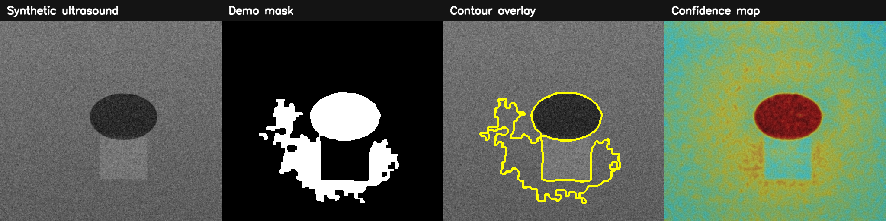

# SonoLesion-AI
### Breast Ultrasound Lesion Analysis Platform

SonoLesion-AI is a research-oriented web application for **2-D breast ultrasound lesion segmentation, contour visualization, quantitative lesion analysis, and model-confidence visualization**. It combines a **FastAPI** inference backend with a **Streamlit** frontend and includes an adapter for a trained **PyTorch/MONAI** segmentation model.

> **Research-use disclaimer:** SonoLesion-AI is a software/research prototype. It is **not a medical device** and must not be used for diagnosis, screening, treatment decisions, or clinical care.



## Features

- Upload breast ultrasound images (`PNG`, `JPG`, `JPEG`, `BMP`, `TIFF`)
- Automatic grayscale conversion and image normalization
- Two inference modes:
  - **Checkpoint mode:** 2-D PyTorch/MONAI segmentation model
  - **Demo mode:** deterministic image-processing heuristic for software demonstration only
- Original image, binary mask, contour overlay, and confidence heatmap
- Quantitative lesion metrics:
  - area
  - perimeter
  - equivalent diameter
  - circularity
  - bounding-box dimensions
- Optional pixel spacing input for approximate physical measurements
- Download mask and annotated image
- FastAPI REST endpoints and Swagger documentation
- Docker Compose setup
- Synthetic ultrasound demo-image generator
- Unit/API tests

## Architecture

```text
Ultrasound image
      |
      v
 Streamlit UI
      |
      v
 FastAPI backend
      |
      +-----------------------------+
      |                             |
      v                             v
 preprocessing                image validation
      |
      v
 +----+------------------------------+
 |                                   |
 v                                   v
trained PyTorch/MONAI model     demo heuristic
 |                                   |
 +----------------+------------------+
                  |
                  v
       mask + probability map
          /        |        \
         v         v         v
      contour    metrics    heatmap
         \         |         /
          +--------+--------+
                   |
                   v
             web dashboard
```

## Repository structure

```text
SonoLesion-AI/
├── backend/
│   ├── main.py
│   ├── config.py
│   ├── schemas.py
│   ├── models/
│   │   └── README.md
│   └── services/
│       ├── inference.py
│       ├── image_io.py
│       └── analysis.py
├── frontend/
│   └── app.py
├── scripts/
│   └── generate_demo_ultrasound.py
├── tests/
│   ├── test_health.py
│   └── test_analysis.py
├── data/
├── results/
├── .env.example
├── .gitignore
├── docker-compose.yml
├── Dockerfile.backend
├── Dockerfile.frontend
├── requirements.txt
├── LICENSE
└── CITATION.cff
```

## Quick start

### 1. Create an environment

```bash
python -m venv .venv
```

Linux/macOS:

```bash
source .venv/bin/activate
```

Windows:

```powershell
.venv\Scripts\activate
```

### 2. Install dependencies

```bash
pip install -r requirements.txt
```

### 3. Generate a synthetic demonstration ultrasound image

```bash
python scripts/generate_demo_ultrasound.py
```

This creates:

```text
data/demo_ultrasound.png
```

### 4. Start the FastAPI backend

```bash
uvicorn backend.main:app --reload --host 0.0.0.0 --port 8000
```

Swagger API documentation:

```text
http://localhost:8000/docs
```

### 5. Start the Streamlit frontend

In another terminal:

```bash
streamlit run frontend/app.py
```

Open:

```text
http://localhost:8501
```

## Using your trained segmentation model

The repository works without a checkpoint in **demo mode**, but demo-mode output is **not a learned prediction** and must not be used for scientific evaluation.

To use your trained model:

1. Place the checkpoint in:

```text
backend/models/sonolesion.pt
```

2. Copy `.env.example` to `.env`.

3. Configure:

```env
SONOLESION_MODEL_PATH=backend/models/sonolesion.pt
SONOLESION_ALLOW_DEMO_MODE=true
SONOLESION_MODEL_INPUT_SIZE=256
```

4. If your EALG-Net or other research architecture differs from the included MONAI U-Net adapter, modify:

```text
backend/services/inference.py
```

Specifically:

```python
build_model()
preprocess_for_model()
predict_with_checkpoint()
```

### Expected model behavior

The default adapter expects:

```text
input : [B, 1, H, W]
output: [B, 1, H, W] logits
```

The output is passed through `sigmoid`, resized to the original image size, and thresholded at the configured segmentation threshold.

If your network returns multiple outputs, deep-supervision heads, or a dictionary, adapt `predict_with_checkpoint()` accordingly.

## API

### Health

```http
GET /health
```

### Analyze ultrasound image

```http
POST /api/v1/analyze
```

Multipart/form fields:

- `image`: ultrasound image
- `pixel_spacing_mm`: optional physical spacing in mm/pixel

Example:

```bash
curl -X POST "http://localhost:8000/api/v1/analyze" \
  -F "image=@data/demo_ultrasound.png" \
  -F "pixel_spacing_mm=0.10"
```

### Retrieve images

```http
GET /api/v1/cases/{case_id}/image/original
GET /api/v1/cases/{case_id}/image/mask
GET /api/v1/cases/{case_id}/image/overlay
GET /api/v1/cases/{case_id}/image/heatmap
```

### Download result files

```http
GET /api/v1/cases/{case_id}/download/mask
GET /api/v1/cases/{case_id}/download/overlay
```

## Quantitative metrics

SonoLesion-AI computes geometric descriptors from the largest detected lesion contour:

- **Area:** number of pixels enclosed by the lesion contour
- **Perimeter:** contour arc length
- **Equivalent diameter:** diameter of a circle with the same area
- **Circularity:** `4πA / P²`
- **Bounding box:** width and height around the largest lesion

If pixel spacing is supplied, area and linear dimensions are additionally estimated in `mm²` and `mm`.

These metrics describe image geometry only. They are not diagnostic indicators.

## Docker

```bash
docker compose up --build
```

Backend:

```text
http://localhost:8000
```

Frontend:

```text
http://localhost:8501
```

## Recommended GitHub screenshots

Add screenshots of:

1. Upload dashboard
2. Original ultrasound image
3. Predicted lesion contour overlay
4. Confidence heatmap
5. Quantitative lesion metrics
6. FastAPI Swagger interface

## Suggested CV entry

**SonoLesion-AI — Breast Ultrasound Lesion Analysis Platform**  
Developed an interactive medical-imaging web application for automated breast-ultrasound lesion segmentation, contour visualization, confidence-map analysis, and quantitative lesion morphology using a FastAPI inference backend and Streamlit interface.

**Technologies:** PyTorch, MONAI, OpenCV, FastAPI, Streamlit, Plotly

## Tests

```bash
pytest -q
```

## License

MIT License.
